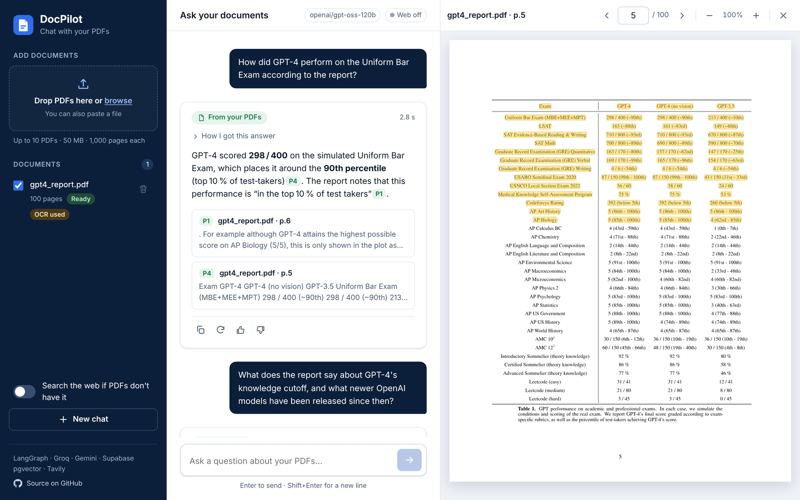
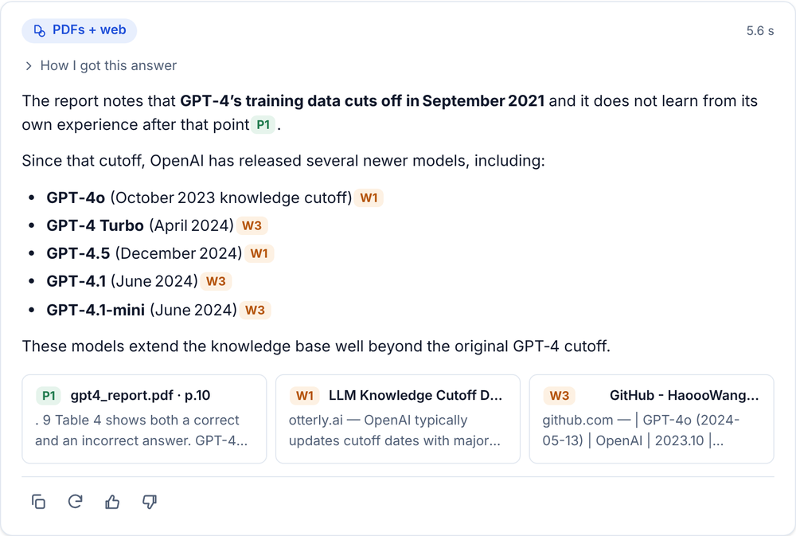
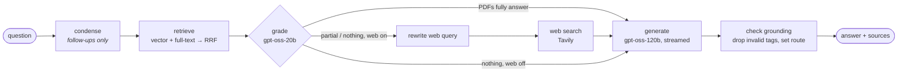

# DocPilot: agentic PDF Q&A with page citations and a labelled web fallback

Upload PDFs and ask questions. DocPilot answers from your documents with **page-level citations you can click** to open the PDF at the cited passage. When the PDFs don't have the answer, it searches the web and **labels that part of the answer as coming from the web**.

**Live demo:** [docpilot-eta.vercel.app](https://docpilot-eta.vercel.app) · **Stack:** LangGraph · Groq (gpt-oss-120b / 20b) · Gemini embeddings · Supabase pgvector · Tavily · FastAPI · Vercel



<p align="center"></p>

## Features

- **Corrective RAG agent** (LangGraph): retrieve → grade relevance → rewrite the query and search the web only when needed → answer → verify citations.
- **Hybrid retrieval**: pgvector cosine (HNSW) + Postgres full-text, merged with Reciprocal Rank Fusion inside one SQL function.
- **Four labelled routes**: *From your PDFs*, *PDFs + web*, *From the web*, *Not found*. The label is computed from the citations that survive verification, not from what the model claims.
- **Clickable citations**: `[P1]` opens the built-in pdf.js viewer at that page and highlights the cited passage; `[W1]` opens the source.
- **Streaming**: Server-Sent Events for every agent step (live timeline: "Checking relevance: 3/6 relevant") and answer tokens; Stop, regenerate, copy.
- **Large PDFs on serverless**: the browser parses PDFs with pdf.js and sends page text in ≤2.5 MB batches (Vercel's request limit is 4.5 MB). Up to 50 MB / 1,000 pages per file, 10 files per chat.
- **Scanned pages**: pages without a text layer are rendered in the browser and transcribed by Gemini vision (capped per file).
- **Prompt-injection hardening**: PDF and web text is fenced as untrusted data; forged delimiters are stripped; covered by tests.
- **Production basics**: per-IP rate limits (salted hashes), session caps, 7-day retention via Vercel Cron, RLS-locked tables, CSP, JSON logs with request ids, no stack traces to clients.

## How it works



Corrective RAG in five lines:
1. Rewrite a follow-up into a standalone question, then fetch the best 6 passages (vector + keyword, fused with RRF).
2. A small, fast model grades which passages are relevant and whether they fully answer the question (strict JSON, parsed defensively).
3. If the answer is incomplete or missing and web search is on, a rewritten query goes to Tavily; failures degrade gracefully.
4. The answer model writes from the provided context only, citing `[P#]` / `[W#]`, preferring PDFs.
5. A grounding pass removes citations that don't exist and derives the route label from what's actually cited.

## Evaluation

`python -m eval.run` uploads two public papers (*Attention Is All You Need*, *RAG* by Lewis et al.) and asks 30 questions: 18 answerable from the PDFs (hand-verified gold pages), 6 that need PDF + web, and 6 current-events questions (asked again with web off, expecting "Not found"). It reports routing accuracy, LLM-as-judge correctness, citation page accuracy and p50/p95 latency.

| Metric (36 runs, run 2) | Result |
|---|---|
| Answer correctness (LLM-as-judge, strict 0/1) | **92%** |
| Routing accuracy (pdf / hybrid / web / none) | **89%** |
| Citation page accuracy (a cited page holds the answer) | **96%** |
| Latency p50 / p95 (end-to-end, non-streamed) | **7.1 s / 10.4 s** |

By category: PDF-only questions are 100% routed and 94% correct; current events with web on are 100% / 100%; web-off "not found" is 100%. Hybrid (PDF + web) is the weak spot: 33% routed, 67% correct. Two-part questions are often judged "fully answered" by the PDF, so web search never runs. Full per-question results, both runs and the bug fixes between them are in [`eval/results.md`](eval/results.md). Nothing was tuned on the questions.

## Run locally

```bash
python3.12 -m venv .venv && source .venv/bin/activate
pip install -r requirements-dev.txt
cp .env.example .env        # add GROQ_API_KEY and GEMINI_API_KEY (Tavily/Supabase optional)
uvicorn app:app --reload    # http://localhost:8000
```

Without Supabase it uses an in-memory store; without a Tavily key, web search is disabled and the UI says so. No keys at all? `python scripts/dev_fake.py` runs the full UI against offline fakes.

```bash
pytest -q && ruff check .                     # 82 offline tests, no keys needed
python scripts/make_sample_pdf.py sample.pdf 300
PDF=sample.pdf node e2e/smoke.mjs             # Playwright: upload → ask → click citation → viewer page
```

## Deploy (Vercel + Supabase)

1. **Supabase**: create a project and run [`supabase/schema.sql`](supabase/schema.sql) in the SQL Editor (idempotent).
2. **Vercel**: import the GitHub repo (zero-config FastAPI: `app` in `app.py`; static files in `public/` go to the CDN). Add the environment variables below for Production and Preview, then deploy.
3. `vercel.json` sets `maxDuration: 300` (the Hobby max), security headers, and a daily cron for `/api/cron/cleanup`.

| Variable | Required | Notes |
|---|---|---|
| `GROQ_API_KEY` | yes | Answer + grading models |
| `GEMINI_API_KEY` | yes | Embeddings and OCR |
| `SUPABASE_URL`, `SUPABASE_SERVICE_KEY` | on Vercel | Service key stays server-side (`sb_secret_…` or legacy `service_role`); the app refuses to start on Vercel without them |
| `TAVILY_API_KEY` | no | Enables web fallback |
| `IP_HASH_SALT` | on Vercel | Random string for hashing client IPs |
| `CRON_SECRET` | recommended | Vercel Cron sends it as a Bearer token |
| `ANSWER_MODEL`, `FAST_MODEL`, `EMBED_MODEL`, `EMBED_DIM`, `OCR_MODEL` | no | Defaults: `openai/gpt-oss-120b`, `openai/gpt-oss-20b`, `gemini-embedding-001`, `768`, `gemini-3.5-flash-lite` |
| `TOP_K`, `CHUNK_SIZE`, `CHUNK_OVERLAP`, `MAX_*`, `RATE_*` | no | Limits; see [`.env.example`](.env.example) |

## API

| Method | Path | |
|---|---|---|
| GET | `/api/health` | store, web/OCR enabled, model names, limits |
| POST | `/api/ingest` | page-text batch from the browser → `{doc_id, chunks}` |
| POST | `/api/ocr` | page image → text |
| POST | `/api/upload` | multipart PDF ≤4 MB, parsed server-side (for API clients) |
| GET / DELETE | `/api/documents` | list / clear a session; `DELETE /api/documents/{id}` removes one |
| POST | `/api/suggest` | 3 starter questions for the latest document |
| POST | `/api/chat` | SSE stream: `step`, `token`, `sources`, `done`, `error`; or `Accept: application/json` |

## Project layout

```
app.py                  FastAPI routes only
docpilot/  config · pdf · embeddings · store · web · llm · graph · ingest · ocr · ratelimit · logs
public/    index.html · css/ · js/ (app, api, ingest, viewer, md) · vendor/pdfjs/
supabase/schema.sql     tables, HNSW + GIN indexes, hybrid RRF function, RLS
eval/      questions.jsonl · run.py · download.py · results.md
tests/     offline unit + API tests with fakes · e2e/smoke.mjs (Playwright)
```

## Limitations and roadmap

- Sessions are anonymous (a random id in the browser) and expire after 7 days; there are no user accounts.
- Gemini's free tier allows ~1,000 embeddings per day (~250 pages); the public demo needs a paid key for large uploads.
- Highlighting matches the cited chunk against the page's text layer; it's best-effort on complex layouts and tables.
- Hybrid two-part questions are under-routed to the web (see eval). Roadmap: decompose multi-part questions before grading, reranker after RRF, table-aware chunking, per-user auth, answer caching, multilingual embeddings.

## License

MIT. See [LICENSE](LICENSE). pdf.js is bundled under Apache-2.0 (`public/vendor/pdfjs/LICENSE`).
